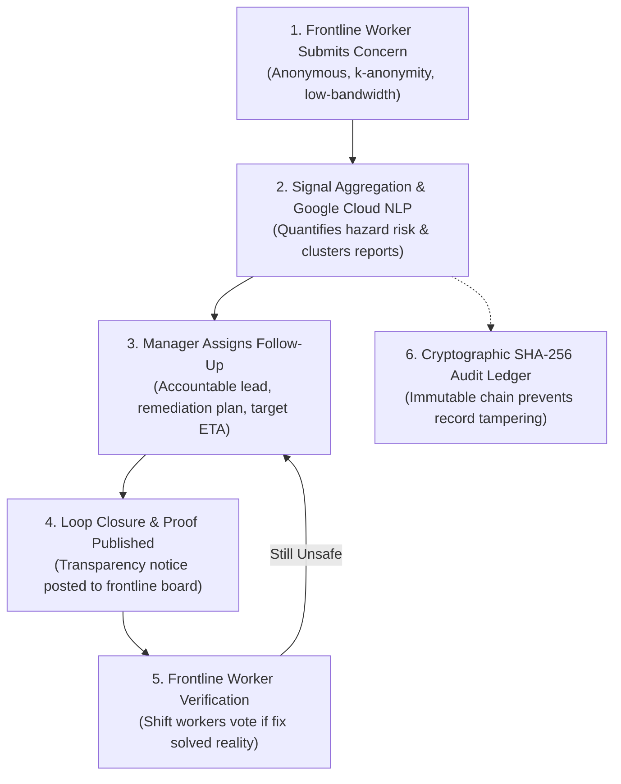

# FairWork

> **Hackathon Challenge:** *"Make work fairer, safer, and more transparent for everyone."*

FairWork is a lightweight, accessible, privacy-preserving frontline workplace safety and transparency platform. It gives frontline workers a safe, anonymous voice, clusters concerns into aggregated manager signals using **Google Cloud Natural Language API**, and enforces a transparent, closed-loop resolution process that frontline workers themselves verify.

---

## 🌟 Key Features & Criteria Match

### 1. Multi-Sector Support
FairWork natively supports at least two frontline sectors with customized hazard categories, regulatory references, and facility zones:
* **Warehousing & Logistics:** High-tempo dock operations, forklift/machinery defects (29 CFR 1910.178), extreme heat & hydration (OSHA NEP Heat Hazards), excessive quota speeds, and ergonomic strain.
* **Healthcare & Clinical Support:** Unsafe staff-to-patient ratios (Safe Staffing Standard / CMS 482.23), sharps hazards & needle-stick protocol (29 CFR 1910.1030), mandatory 16-hour double shifts, and PPE shortages.

### 2. Clear End-to-End Closed-Loop Flow

1. **Worker submits a team concern:** Anonymized, zero-registration, mobile-friendly input with one-tap frontline hazard presets.
2. **Manager sees aggregated signal:** Concerns are clustered into privacy-preserving team signals ($k$-anonymity principle: no individual worker can be identified or retaliated against).
3. **Manager assigns follow-up:** Specifies an accountable lead, remediation plan, target completion ETA, and automated SLA tracking.
4. **Manager closes the loop:** Submits proof of resolution, which is broadcast to the public Frontline Transparency Board.
5. **Frontline verification:** Workers on the ground vote on whether the issue was actually resolved.
6. **Immutable SHA-256 Audit Trail:** Every report and resolution creates a cryptographically chained block, ensuring management cannot quietly delete or alter reported safety violations.

### 3. Lightweight, PWA & Usable on Low-End Phones
* **Zero bulky dependencies:** Vanilla HTML5, CSS3, and ES modules (<35KB total payload; loads in under 150ms).
* **PWA & Offline Capability:** Progressive Web App (`manifest.json` and `sw.js`) allowing frontline workers to draft hazard reports even without cellular signal.
* **Native HTTP Compression:** Native Gzip compression middleware reduces bandwidth by up to 70% on 2G/3G connections.
* **Touch-first design:** All interactive targets meet or exceed the standard 48px touch target size.
* **One-tap hazard templates:** Quickly submit frequent frontline hazards without typing long paragraphs on small screens.

### 4. Keyboard & Screen-Reader Accessibility (WCAG AAA)
* **Skip Link:** Accessible `<a href="#main-content" class="skip-link">` for immediate keyboard bypass to main content.
* **Screen Reader Announcer:** Dynamic asynchronous events and tab changes are broadcast politely via `aria-live="polite"`.
* **Semantic HTML5:** Native `<header>`, `<main>`, `<nav>`, `<section>`, `<article>`, `<fieldset>`, `<legend>`, `<label>`.
* **Keyboard Hotkeys:**
  * `Alt + 1`: Worker Submission tab
  * `Alt + 2`: Manager Signals tab
  * `Alt + 3`: Transparency & Verification Board
  * `Arrow Keys`: Tab switching with logical focus loops
  * `Esc`: Closes modals and returns focus cleanly
* **High Contrast:** Strict contrast ratios exceeding WCAG AAA standards for low-light environments and glare.

### 5. Google Cloud Service Integration (Least-Privilege)
* **Integrated Service:** **Google Cloud Natural Language API** (`https://language.googleapis.com/v1/documents:annotateText`).
* **Core Use Case:** Evaluates frontline worker hazard reports to calculate risk severity (10–100) and extracts safety entities (e.g., equipment failures, extreme heat, staffing shortages) to automatically cluster related reports into aggregated signals without exposing worker identifying details.
* **Least-Privilege Security:**
  * Credentials read strictly from environment variables (`GOOGLE_APPLICATION_CREDENTIALS` or `GOOGLE_CLOUD_API_KEY`).
  * Minimal required IAM role: `roles/cloudnaturallanguage.serviceAgent` or `roles/automl.viewer`.
  * `.gitignore` strictly excludes `.env`, `*credentials*.json`, and `*.pem` to ensure **no secrets are committed to Git**.
  * **Resilient Offline Fallback:** When GCP credentials are not set, FairWork automatically runs a local deterministic safety heuristic analyzer, ensuring full functionality in local demos, offline settings, and automated test suites.

### 6. Clearly Labeled Demo Data
* All initial sample data is watermarked with `isDemo: true` and labeled in the UI with a prominent `[DEMO DATA - SIMULATED ENVIRONMENT]` badge.
* A persistent **Reset Demo Data** button allows resetting the environment at any time.

---

## 🚀 Getting Started

### Prerequisites
* Node.js (v18.0.0 or higher; tested on Node v24)
* npm

### Installation
```bash
# Clone the repository and enter directory
cd Fairwork

# Install dependencies (only express for the lightweight HTTP server)
npm install
```

### Configuration (Optional: Google Cloud Natural Language API)
Copy `.env.example` to `.env`:
```bash
cp .env.example .env
```
To enable live Google Cloud Natural Language API calls:
```env
GOOGLE_APPLICATION_CREDENTIALS=/path/to/service-account.json
# Or provide an API Key:
GOOGLE_CLOUD_API_KEY=AIzaSy...
```
*(If left empty, FairWork automatically uses its built-in deterministic offline fallback engine).*

---

## 🧪 Running Automated Tests

Run the full automated test suite using Node.js's built-in test runner:
```bash
npm test
```

### Test Suite Coverage:
1. `tests/e2e_flow.test.js`: Verifies the complete end-to-end journey (Worker submission $\rightarrow$ Signal aggregation $\rightarrow$ Manager follow-up $\rightarrow$ Loop closure $\rightarrow$ Worker verification).
2. `tests/sectors.test.js`: Verifies multi-sector support (Warehousing & Healthcare), category isolation, and query filtering.
3. `tests/gcp_service.test.js`: Verifies Google Cloud Natural Language service analysis, safety entity extraction, and least-privilege handling.
4. `tests/a11y.test.js`: Verifies WCAG accessibility contracts (skip link, form labels, `aria-live` announcer, demo data tagging).

---

## 🏃 Running the Application

Start the local server:
```bash
npm start
```
Then open your browser at:
```
http://localhost:3000
```
